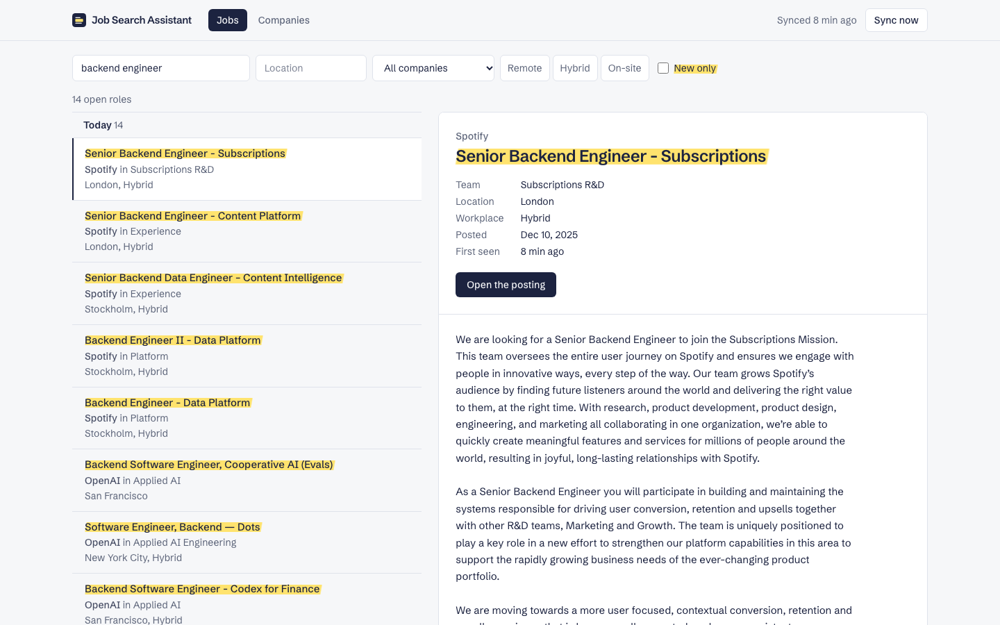
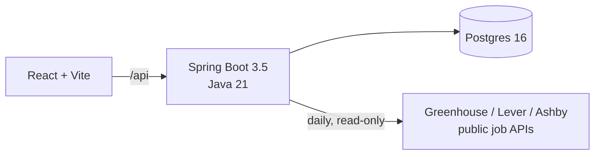

# Job Search Assistant

A personal tool for a referral-first job search. Every morning it reads the job boards of the companies I'm targeting, keeps track of which roles are new, and puts them in one inbox, because the best time to ask someone for a referral is the week a role opens.

It reads jobs straight from the hiring systems companies use (Greenhouse, Lever and Ashby) through their public APIs. It never automates LinkedIn: finding people and sending messages stay in my hands.



## What it does today

- **Add a company by pasting its careers link.** The app works out the ATS and board (`jobs.lever.co/palantir` → Lever, `palantir`) and shows you before you save.
- **Daily sync.** At 07:00 it pulls every company's open roles, adds new ones, refreshes the rest, and closes roles that left the board. One broken board never stops the others, and a board that disappears (companies switch ATS) is flagged so you can paste the new link.
- **An inbox ordered by freshness.** Roles are grouped by when they were first seen, new ones are highlighted, and you can filter by title or team keywords, location, company, and remote / hybrid / on-site.

On the first real run it pulled 1,073 open roles from Airbnb, Spotify and OpenAI in about five seconds.


## What's next

| Phase | Scope |
|---|---|
| 2 | Contacts and outreach tracker: who I messaged about which role, replies, follow-up reminders |
| 3 | AI ranking of the shortlist against my resume, and drafted referral messages I review and send |
| 4 | Browser extension: save the profile I'm viewing; fill application forms (I always press submit) |
| 5 | Tailored resumes and cover letters, a reusable answer bank, reply-rate stats |

## How it's built



- **Backend:** Java 21, Spring Boot 3.5, Spring Data JPA, Flyway, `RestClient`. Code is organised by feature (`company`, `job`, `job.source`). Each ATS is one class behind a `JobSource` interface, so adding SmartRecruiters is one class.
- **Frontend:** React 19, Vite, Tailwind CSS 4, TanStack Query. Filters live in the URL, so any view can be bookmarked.
- **Data:** Postgres, schema managed by Flyway; Hibernate only validates it.
- **Tests:** 45 unit tests, including each ATS client against recorded real responses, plus 18 integration tests of the sync and the REST API against real Postgres via Testcontainers. Frontend tests use Vitest and Testing Library. CI runs everything on every push.

The full design, with diagrams of the sync, the data model and the roadmap, is in [docs/architecture.md](docs/architecture.md). The decisions with real trade-offs are in [docs/adr](docs/adr).

## Design choices worth a look

- **Never delete a job.** A role that leaves the feed is closed, not removed, so the outreach history about it survives. If it reappears it reopens, keeping the date it was first seen.
- **The fetch runs outside the transaction.** HTTP calls to job boards happen first. Each company is then reconciled in its own short transaction, so a slow board never holds a database connection and one failure never rolls back another company.
- **Normalise at the edge.** Each ATS describes jobs differently: Ashby marks hybrid roles `isRemote: true`, and Greenhouse hides the workplace in a custom field and sends HTML-escaped HTML. Each client maps its feed into one `FetchedJob` record, and nothing past it knows which ATS a job came from.
- **Local and single-user on purpose.** Everything binds to `127.0.0.1`; there's no login because there's no network exposure ([ADR 0001](docs/adr/0001-single-user-local-first.md)). It costs nothing to run.

## Run it

You need Docker.

```sh
docker compose up -d --build
```

Open http://localhost:8081, go to Companies, and paste a careers link such as `https://jobs.ashbyhq.com/openai`. Then press **Sync now**.

### Develop

```sh
docker compose up -d db              # Postgres on localhost:5433

cd backend && ./mvnw spring-boot:run # API on localhost:8080
cd frontend && npm install && npm run dev   # app on localhost:5173, proxies /api

cd backend && ./mvnw verify          # all backend tests (integration tests need Docker)
cd frontend && npm test && npm run lint
```

### API

| Method | Path | |
|---|---|---|
| `GET` | `/api/jobs?q=&location=&companyId=&workplace=REMOTE&newOnly=&includeClosed=&page=&size=` | Search open roles, newest first |
| `GET` | `/api/jobs/{id}` | One role with its description |
| `GET` `POST` | `/api/companies` | List or add companies (`{"careersUrl": "..."}`) |
| `POST` | `/api/companies/detect` | Preview what a careers link resolves to |
| `PATCH` `DELETE` | `/api/companies/{id}` | Rename, pause, re-link or remove |
| `POST` | `/api/sync`, `/api/companies/{id}/sync` | Sync every company, or one, now |

Errors are RFC 7807 problem details.
