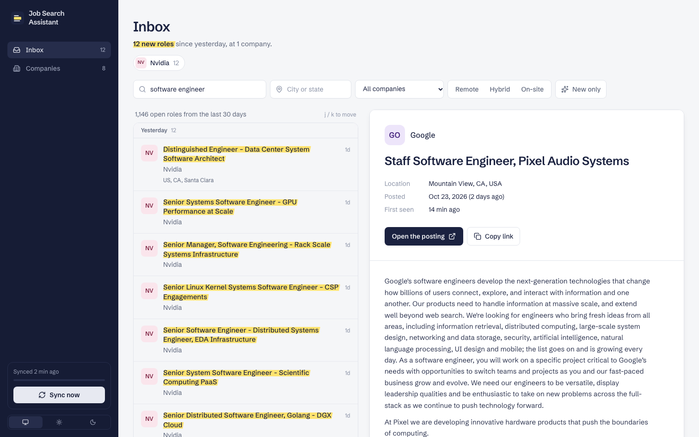
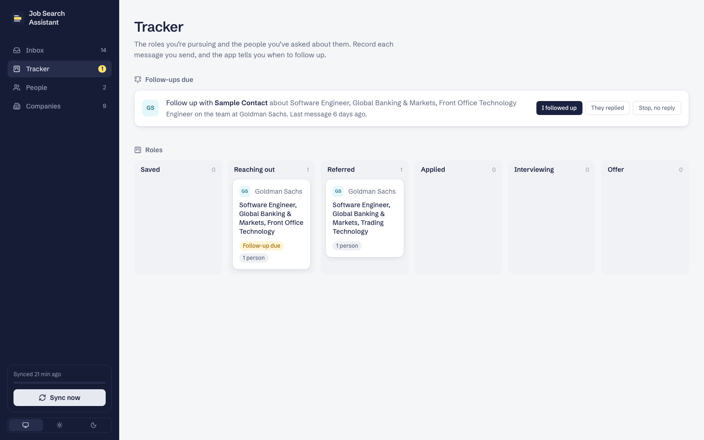
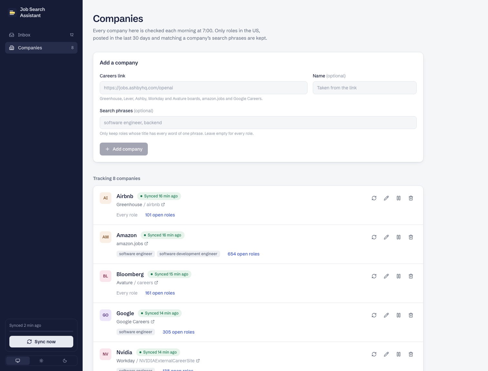
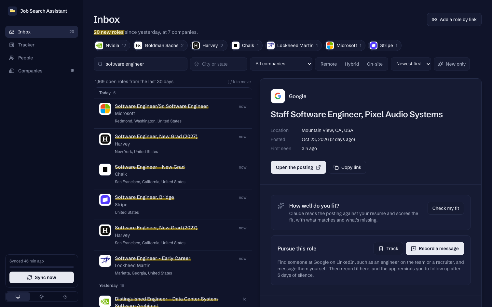
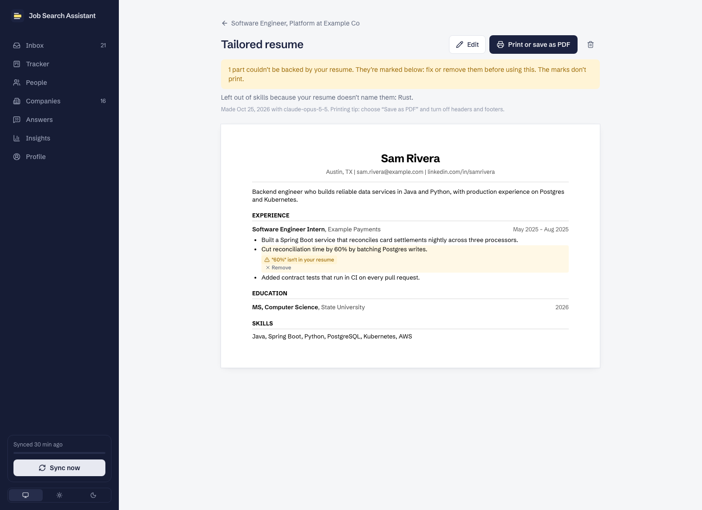
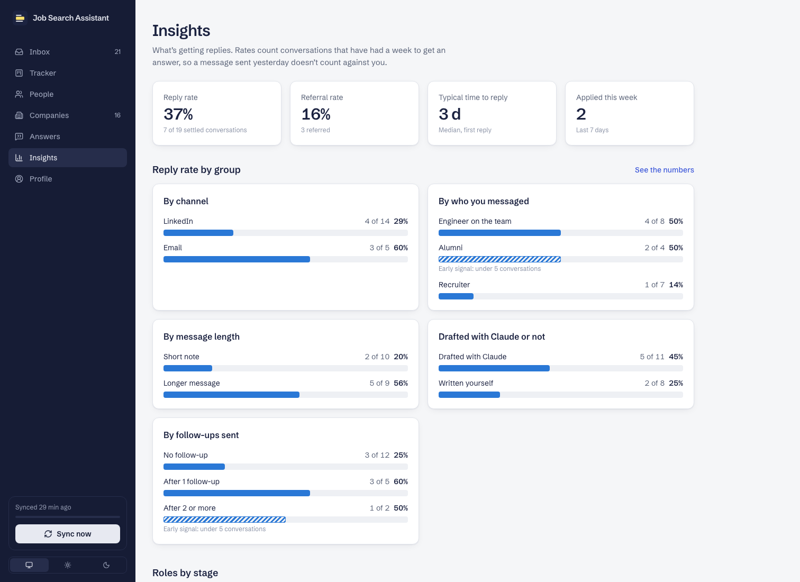
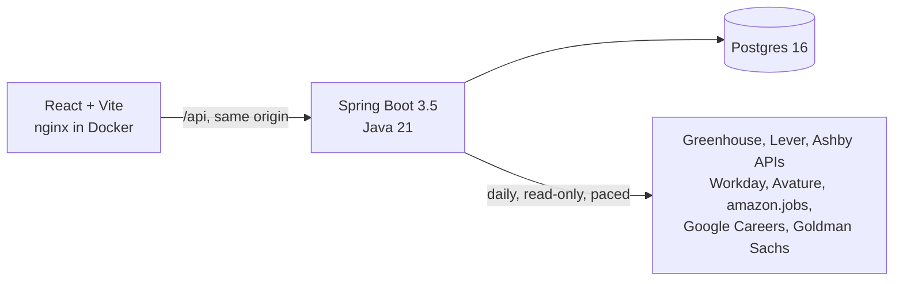

# Job Search Assistant

A personal tool for a referral-first job search. Every morning it reads the careers sites of the companies I'm targeting, from Airbnb's Greenhouse board to amazon.jobs, Google Careers and Goldman Sachs, keeps the US roles posted in the last 30 days, and puts them in one inbox with the new ones marked. The best time to ask someone for a referral is the week a role opens.

Then it keeps track of the referral hunt itself: the roles I'm pursuing, the people I've asked, and when to follow up. It never automates LinkedIn, and it never works around a site's access controls. Finding people and sending messages stay in my hands.



## What it does today

- **Add a company by pasting its careers link.** The app recognises eight kinds of site and shows what it found before you save: Greenhouse, Lever, Ashby, Workday (Nvidia, Salesforce, Adobe…), Avature (Bloomberg), amazon.jobs, Google Careers and Goldman Sachs.
- **Keeps only what's relevant:** roles in the US, posted in the last 30 days, and matching each company's search phrases. Amazon posts over 200 US roles a day; "software engineer, backend" turns that into a list worth reading.
- **Hides roles that won't sponsor a visa.** One switch hides roles for U.S. citizens or green card holders only, roles needing a security clearance, roles that say they won't sponsor, and companies you've marked as not sponsoring. Each restricted role quotes the sentence from its posting, so you can judge it; roles that only *may* have legal status rules stay visible with a label.
- **Syncs every morning in the background,** with live progress in the sidebar. Roles that leave a board are closed, never deleted. One broken site never stops the others, and a company that moves to another system is flagged so you can paste the new link.
- **An inbox you can scan.** Company logos throughout, fetched once and served by the app itself.
- **An inbox ordered by freshness.** Roles are grouped by the day they were posted, new ones are highlighted, and a digest at the top shows which companies posted today. You can filter by keyword, location, company and remote / hybrid / on-site, and move through roles with j and k.
- **A tracker for the referral hunt.** Track a role and record each message you send; the app reminds you to follow up after 5 days of silence and moves the role along as people reply and refer you (Saved → Reaching out → Referred → Applied → Interviewing → Offer). A People page keeps everyone you've talked to and where each conversation stands.
- **Roles from anywhere.** Paste a link from LinkedIn or any careers site to add a role the app can't sync. If the link is on a board it can read, it offers to track the whole company.
- **Your fit, at a glance.** Claude reads each new role against your resume and scores it from 0 to 100, with what matches and what's missing; the inbox can sort by best fit. It also drafts LinkedIn connection notes, messages and follow-ups from facts on your resume, for you to edit and send.
- **A browser extension.** On a LinkedIn profile, one click saves the person to your People list; on a LinkedIn job, it adds the role. On an application form (Greenhouse, Lever, Ashby, Workday), it fills your details from your Profile and attaches your resume, leaves work-authorization, sponsorship and EEO questions for you, and never submits. After you submit, it records the application in the tracker. [Install](extension/README.md).
- **A resume and cover letter for each role.** Claude rewrites your resume for a posting, or writes a cover letter, and the app checks the result against your real resume: a bullet whose source line isn't in it, or a number you never wrote ("cut latency by 60%"), is highlighted with the reason, and skills you don't list are dropped. Fix or remove what's flagged, then print it or save it as a PDF; the marks don't print.
- **An answer bank.** Save your answers to the questions every form asks, or have Claude draft one for a role. On an application, the extension fills a long-answer box whose question matches a saved one and outlines it in blue for you to read.
- **Insights.** Reply and referral rates by channel, by who you messaged, by message length, by whether Claude drafted it and by follow-ups. Rates only count conversations that have had a week to get a reply, and small groups are marked as early signals.
- **Job-alert emails, silently.** For sites that can't be read (Microsoft, Meta, Apple) and LinkedIn-only roles, the app reads job-alert emails from a Gmail label each morning, read-only, and adds their roles to the inbox. A Gmail filter keeps the alerts out of your inbox, so they never buzz. [Setup guide](docs/gmail-setup.md).

On a real run it kept about 1,460 relevant US roles from eight companies, including 654 software roles from Amazon, 305 from Google, 138 from Nvidia and 161 from Bloomberg.



<table>
  <tr>
    <td></td>
    <td></td>
  </tr>
</table>

<table>
  <tr>
    <td></td>
    <td></td>
  </tr>
</table>

<sub>These two screenshots use made-up sample data.</sub>

## How it's built



- **Backend:** Java 21, Spring Boot 3.5, Spring Data JPA, Flyway, `RestClient`, jsoup, the Gmail API with Google OAuth, and Claude through the Anthropic Java SDK. Organised by feature (`company`, `job`, `job.source`, `contact`, `tracker`, `alerts`, `ai`, `profile`, `answers`, `documents`). Each site is one class behind a `JobSource` interface.
- **Extension:** Chrome Manifest V3 in plain JavaScript, with only `activeTab` access; the page reader and form filler are tested against sample pages and a real Lever form.
- **Frontend:** React 19, Vite, Tailwind CSS 4, TanStack Query, lucide icons. Filters and the open role live in the URL, so any view can be bookmarked. Light and dark themes.
- **Tests:** 370 in total. Every site source is tested against a trimmed copy of a real response, and the alert parsers against sample emails; the sync and the REST API run against real Postgres via Testcontainers; UI components are tested with Vitest and Testing Library. CI runs everything on every push.

The full design, with diagrams of the sync, the data model, the deployment path and the roadmap, is in [docs/architecture.md](docs/architecture.md). The decisions with real trade-offs are in [docs/adr](docs/adr).

## Design choices worth a look

- **One interface, eight very different sites.** Some are documented APIs, some are the JSON or GraphQL a careers page loads, and two are HTML pages. Each client maps its site into one `FetchedJob` record, and nothing past it knows where a role came from. Each site has its own quirks: Ashby marks hybrid roles `isRemote: true`, Workday only says "Posted 3 Days Ago", and Google's listings are a positional JSON array inside a script tag.
- **Coverage-aware closing.** Search feeds stop paging at the 30-day cutoff, so a role missing from them may still be open. Each fetch reports how far back it is complete, and the sync only closes roles inside that window.
- **"New" means new to you.** Adding a company doesn't flood the inbox: roles seen on its first import count as new only if they were posted in the last day.
- **Conservative US detection.** Locations are free text ("US, CA, Santa Clara", "Remote - US", "Toronto"). Structured country fields are used where a feed has them; otherwise the rules answer "unknown" rather than guess, so a US role is never dropped by mistake.
- **AI with guard rails.** Claude answers in JSON matching a schema, job postings are fenced off as untrusted data, drafts may only use facts from the resume, refusals fall back server-side, and the daily scoring run has a hard cap. Tests never call the API: a fake covers the features and a local stub of the Messages API checks the exact request the SDK sends.
- **State rules in the domain.** A conversation's moves (sent, followed up, replied, referred) and a role's stages live in the entities and are unit-tested without a database. Follow-up reminders are a date on the conversation and a query, not a background job.
- **Respectful by default.** One sync a day, paced pages, a page cap, an honest `User-Agent`, and no reading of sites that require a login, token or bot check ([ADR 0004](docs/adr/0004-unofficial-feeds.md)).
- **Local today, deployable by design.** Configuration from the environment, containers with health probes, Flyway migrations, a background sync instead of long requests, and a same-origin nginx front end with security headers. Hosting it is a short checklist, starting with authentication ([ADR 0005](docs/adr/0005-deployable-by-design.md)).

## Run it

You need Docker.

```sh
docker compose up -d --build
```

Open http://localhost:8081, go to **Companies**, and paste a careers link such as `https://jobs.ashbyhq.com/openai` or `https://www.amazon.jobs` (with search phrases like `software engineer`). Then press **Sync now**.

### Develop

```sh
docker compose up -d db                     # Postgres on localhost:5433

cd backend && ./mvnw spring-boot:run        # API on localhost:8080
cd frontend && npm install && npm run dev   # app on localhost:5173, proxies /api

cd backend && ./mvnw verify                 # all backend tests (integration tests need Docker)
cd frontend && npm test && npm run lint
```

### Configuration

| Variable | Default | |
|---|---|---|
| `JOBS_US_ONLY` | `true` | Only keep roles in the US |
| `JOBS_MAX_AGE` | `30d` | Don't import roles posted longer ago than this |
| `SYNC_CRON` | `0 0 7 * * *` | When the daily sync runs (server time zone, `TZ`) |
| `SYNC_ENABLED` | `true` | Turn the daily sync off |
| `FOLLOW_UP_AFTER` | `5d` | When to remind you to follow up on a message with no reply |
| `GOOGLE_CLIENT_ID`, `GOOGLE_CLIENT_SECRET` | none | A Google OAuth client for reading job-alert emails ([setup](docs/gmail-setup.md)); put them in `.env` |
| `GMAIL_LABEL` | `Job alerts` | The Gmail label alert emails are filed under |
| `ANTHROPIC_API_KEY` | none | Claude, for match scores and drafts; put it in `.env` |
| `AI_MODEL` | `claude-opus-5-5` | Which Claude model to use |
| `AI_DAILY_LIMIT` | `30` | New roles scored automatically after each daily sync |
| `AI_REQUEST_CAP` | `150` | Hard ceiling on Claude requests per day of any kind |
| `DB_URL`, `DB_USER`, `DB_PASSWORD` | local Postgres | Database |

### API

| Method | Path | |
|---|---|---|
| `GET` | `/api/jobs?q=&location=&companyId=&workplace=REMOTE&newOnly=&needsSponsorship=&sort=fit&includeOlder=&includeClosed=&page=&size=` | Search open roles, most recently posted first |
| `GET` | `/api/jobs/summary?needsSponsorship=` | New roles since yesterday, by company |
| `GET` | `/api/jobs/{id}` | One role with its description |
| `GET` `POST` | `/api/companies` | List or add companies (`{"careersUrl": "...", "search": "software engineer"}`) |
| `POST` | `/api/companies/detect` | Preview what a careers link resolves to |
| `PATCH` `DELETE` | `/api/companies/{id}` | Rename, change search phrases, pause, re-link or remove |
| `POST` | `/api/sync`, `/api/companies/{id}/sync` | Start a background sync of every company, or one (202) |
| `GET` | `/api/sync` | Progress of the current or last sync |
| `POST` `PATCH` | `/api/jobs`, `/api/jobs/{id}` | Add a role by link; close or reopen a role added by hand |
| `GET` `POST` `PATCH` `DELETE` | `/api/contacts`, `/api/contacts/{id}` | People at each company |
| `GET` `POST` `PATCH` `DELETE` | `/api/pursuits`, `/api/pursuits/{id}` | Tracked roles and their stage |
| `GET` | `/api/jobs/{id}/tracking`, `/api/contacts/{id}/outreach` | Conversations about a role, or with a person |
| `POST` | `/api/outreach`, `/api/outreach/{id}/events` | Record a message you sent; record a follow-up, reply, referral or note |
| `GET` | `/api/outreach/due` | Follow-ups due today |
| `GET` `DELETE` | `/api/gmail` | Gmail connection and last import; disconnect (revokes access) |
| `GET` | `/api/gmail/connect`, `/api/gmail/callback` | Google sign-in, read-only |
| `POST` | `/api/gmail/import` | Read new job-alert emails now (202) |
| `GET` | `/api/ai` | Whether Claude is set up, and which resume it reads |
| `POST` | `/api/jobs/{id}/match` | Score one role against the resume |
| `POST` | `/api/drafts` | Draft a connection note, message or follow-up |
| `GET` `PUT` | `/api/profile` | Your details for application forms |
| `POST` | `/api/profile/from-resume` | Claude's reading of your resume, to review before saving |
| `GET` | `/api/profile/resume` | The resume file, for the extension to attach |
| `POST` | `/api/applications` | Record an application: tracks the role as Applied |
| `GET` `POST` | `/api/jobs/{id}/documents` | A role's tailored documents; tailor a resume or write a cover letter (`{"kind": "RESUME"}`) |
| `GET` `PATCH` `DELETE` | `/api/documents/{id}` | One tailored document; save edits |
| `GET` `POST` `PATCH` `DELETE` | `/api/answers?q=`, `/api/answers/{id}` | The answer bank |
| `POST` | `/api/answers/match`, `/api/answers/draft`, `/api/answers/{id}/used` | Match a form's questions to saved answers; draft one with Claude; count a use |
| `GET` | `/api/insights` | Reply and referral rates by group, time to reply, roles by stage |

Errors are RFC 7807 problem details.
