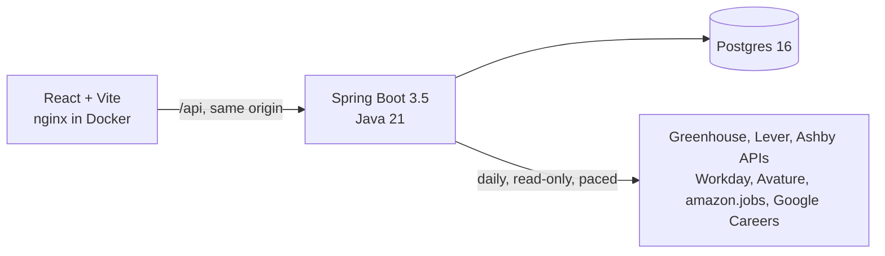

# Job Search Assistant

A personal tool for a referral-first job search. Every morning it reads the careers sites of the companies I'm targeting, from Airbnb's Greenhouse board to amazon.jobs and Google Careers, keeps the US roles posted in the last 30 days, and puts them in one inbox with the new ones marked. The best time to ask someone for a referral is the week a role opens.

It never automates LinkedIn, and it never works around a site's access controls. Finding people and sending messages stay in my hands.


## What it does today

- **Add a company by pasting its careers link.** The app recognises seven kinds of site and shows what it found before you save: Greenhouse, Lever, Ashby, Workday (Nvidia, Salesforce, Adobe…), Avature (Bloomberg), amazon.jobs and Google Careers.
- **Keeps only what's relevant:** roles in the US, posted in the last 30 days, and matching each company's search phrases. Amazon posts over 200 US roles a day; "software engineer, backend" turns that into a list worth reading.
- **Syncs every morning in the background,** with live progress in the sidebar. Roles that leave a board are closed, never deleted. One broken site never stops the others, and a company that moves to another system is flagged so you can paste the new link.
- **An inbox ordered by freshness.** Roles are grouped by the day they were posted, new ones are highlighted, and a digest at the top shows which companies posted today. You can filter by keyword, location, company and remote / hybrid / on-site, and move through roles with j and k.

On a real run it kept about 1,460 relevant US roles from eight companies, including 654 software roles from Amazon, 305 from Google, 138 from Nvidia and 161 from Bloomberg.

<table>
  <tr>
    <td></td>
    <td></td>
  </tr>
</table>

## What's next

| Phase | Scope |
|---|---|
| 2 | Contacts and outreach tracker: who I messaged about which role, replies, follow-up reminders; paste a job link from any site |
| 3 | AI ranking of the shortlist against my resume, and drafted referral messages I review and send |
| 4 | Browser extension: save the profile I'm viewing; fill application forms (I always press submit) |
| 5 | Tailored resumes and cover letters, a reusable answer bank, reply-rate stats |

## How it's built



- **Backend:** Java 21, Spring Boot 3.5, Spring Data JPA, Flyway, `RestClient`, jsoup. Organised by feature (`company`, `job`, `job.source`). Each site is one class behind a `JobSource` interface.
- **Frontend:** React 19, Vite, Tailwind CSS 4, TanStack Query, lucide icons. Filters and the open role live in the URL, so any view can be bookmarked. Light and dark themes.
- **Tests:** 170 in total. Every source is tested against a trimmed copy of a real response; the sync and the REST API run against real Postgres via Testcontainers; UI components are tested with Vitest and Testing Library. CI runs everything on every push.

The full design, with diagrams of the sync, the data model, the deployment path and the roadmap, is in [docs/architecture.md](docs/architecture.md). The decisions with real trade-offs are in [docs/adr](docs/adr).

## Design choices worth a look

- **One interface, seven very different sites.** Some are documented APIs, some are the JSON a careers page loads, and two are HTML pages. Each client maps its site into one `FetchedJob` record, and nothing past it knows where a role came from. Each site has its own quirks: Ashby marks hybrid roles `isRemote: true`, Workday only says "Posted 3 Days Ago", and Google's listings are a positional JSON array inside a script tag.
- **Coverage-aware closing.** Search feeds stop paging at the 30-day cutoff, so a role missing from them may still be open. Each fetch reports how far back it is complete, and the sync only closes roles inside that window.
- **"New" means new to you.** Adding a company doesn't flood the inbox: roles seen on its first import count as new only if they were posted in the last day.
- **Conservative US detection.** Locations are free text ("US, CA, Santa Clara", "Remote - US", "Toronto"). Structured country fields are used where a feed has them; otherwise the rules answer "unknown" rather than guess, so a US role is never dropped by mistake.
- **Respectful by default.** One sync a day, paced pages, a page cap, an honest `User-Agent`, and no reading of sites that require a login, token or bot check ([ADR 0004](docs/adr/0004-unofficial-feeds.md)).
- **Local today, deployable by design.** Configuration from the environment, containers with health probes, Flyway migrations, a background sync instead of long requests, and a same-origin nginx front end with security headers. Hosting it is a short checklist, starting with authentication ([ADR 0005](docs/adr/0005-deployable-by-design.md)).

## Run it

You need Docker.

```sh
docker compose up -d --build
```

Open http://localhost:8081, go to **Companies**, and paste a careers link such as `https://jobs.ashbyhq.com/openai` or `https://www.amazon.jobs` (with search phrases like `software engineer`). Then press **Sync now**.

### Develop

```sh
docker compose up -d db                     # Postgres on localhost:5433

cd backend && ./mvnw spring-boot:run        # API on localhost:8080
cd frontend && npm install && npm run dev   # app on localhost:5173, proxies /api

cd backend && ./mvnw verify                 # all backend tests (integration tests need Docker)
cd frontend && npm test && npm run lint
```

### Configuration

| Variable | Default | |
|---|---|---|
| `JOBS_US_ONLY` | `true` | Only keep roles in the US |
| `JOBS_MAX_AGE` | `30d` | Don't import roles posted longer ago than this |
| `SYNC_CRON` | `0 0 7 * * *` | When the daily sync runs (server time zone, `TZ`) |
| `SYNC_ENABLED` | `true` | Turn the daily sync off |
| `DB_URL`, `DB_USER`, `DB_PASSWORD` | local Postgres | Database |

### API

| Method | Path | |
|---|---|---|
| `GET` | `/api/jobs?q=&location=&companyId=&workplace=REMOTE&newOnly=&includeOlder=&includeClosed=&page=&size=` | Search open roles, most recently posted first |
| `GET` | `/api/jobs/summary` | New roles since yesterday, by company |
| `GET` | `/api/jobs/{id}` | One role with its description |
| `GET` `POST` | `/api/companies` | List or add companies (`{"careersUrl": "...", "search": "software engineer"}`) |
| `POST` | `/api/companies/detect` | Preview what a careers link resolves to |
| `PATCH` `DELETE` | `/api/companies/{id}` | Rename, change search phrases, pause, re-link or remove |
| `POST` | `/api/sync`, `/api/companies/{id}/sync` | Start a background sync of every company, or one (202) |
| `GET` | `/api/sync` | Progress of the current or last sync |

Errors are RFC 7807 problem details.
