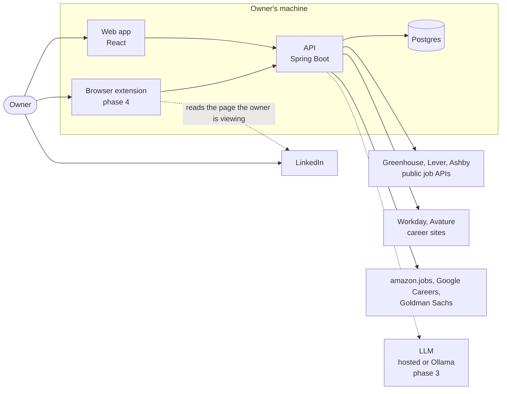
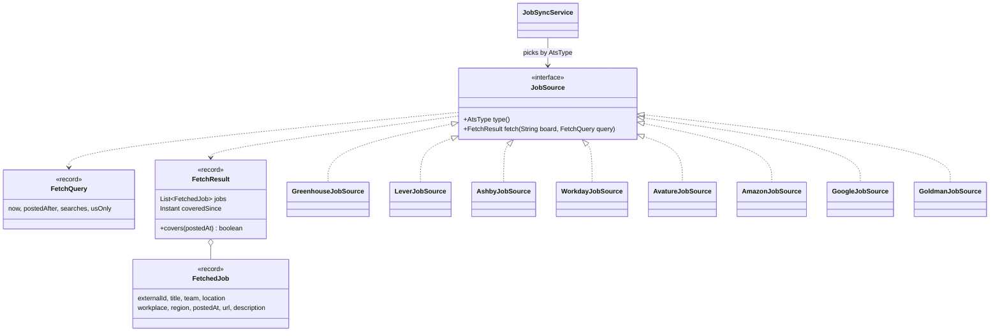
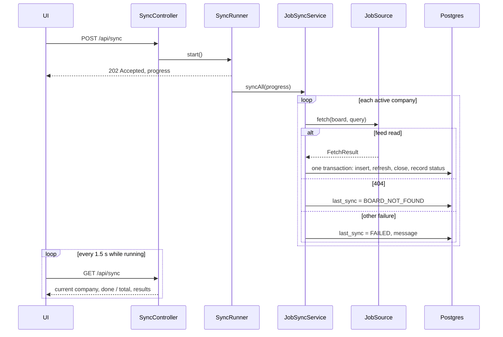
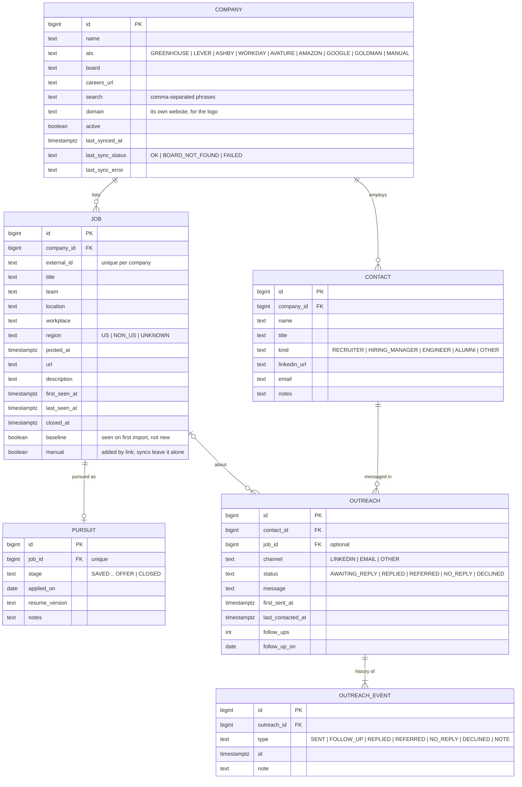
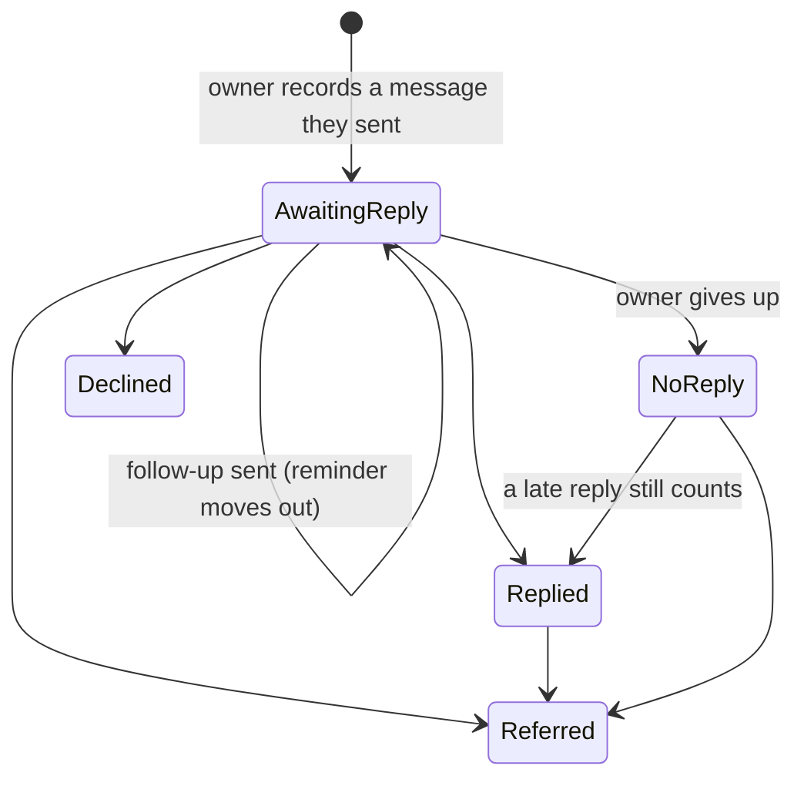
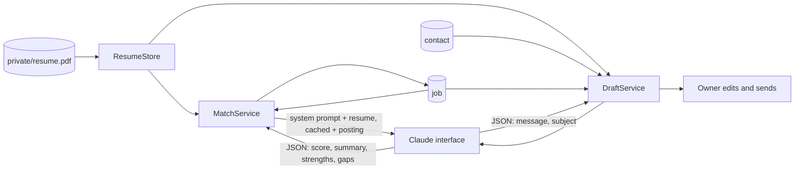

# System design

This is the design of Job Search Assistant: what it does, how the parts fit, and why it is built this way. The product brief is in [BRIEF.md](BRIEF.md); decisions with real trade-offs are recorded as ADRs in [adr/](adr/).

## 1. Problem

Applying cold has a low response rate. A referral from someone inside the company is the strongest signal a candidate can send, and it works best when the role is fresh. The work around a referral is tedious: watching career pages, spotting new roles, finding the right person, writing a personal note, remembering to follow up, and filling the same application forms again and again.

The app does that work. The owner keeps every judgement call and every send.

## 2. Goals and non-goals

**Goals**
- Pull open roles every day from the hiring systems (ATS) that target companies use, and flag what is new.
- Narrow those roles with cheap filters first, then rank the shortlist against the owner's resume with AI.
- Keep a record of the people at each company and every conversation with them, with follow-up reminders.
- Draft personal referral messages and tailored application documents for the owner to review.
- Fill application forms in the browser so that applying is mostly review.

**Non-goals**
- A multi-user product. There is one user, on one machine.
- Volume. The target is 10 to 20 personal messages a day, not hundreds.

**Anti-goals** (the app has failed if it does these, even if it works)
- Automating LinkedIn in any way: scraping, sending messages or connection requests, or applying. It breaks LinkedIn's User Agreement and would put the owner's account at risk.
- Submitting anything without the owner pressing the button. Legal attestations (work authorization, sponsorship, EEO) must be the owner's own answers.
- Inventing experience in a resume or cover letter.
- Costing money to run, beyond free tiers.

## 3. System context



The API is the only thing that talks to the outside world, and it only reads from it. LinkedIn appears only as a page the owner is looking at: the extension reads that one page when the owner clicks, and never navigates or sends.

## 4. Components

| Component | Tech | Responsibility |
|---|---|---|
| `backend/` | Java 21, Spring Boot 3.5, JPA, Flyway, jsoup | REST API, job sources, background sync, tracker, AI calls |
| `frontend/` | React 19, Vite, Tailwind CSS 4, TanStack Query, lucide icons | Inbox, tracker board, people, companies |
| Postgres 16 | Docker Compose | All state |
| Browser extension | Chrome MV3, unpacked | Save a viewed profile; fill application forms (phase 4) |

The backend is organised **by feature** rather than by layer (`company`, `job`, `job.source`, `contact`, `tracker`, `alerts`, `ai`), so each feature's entity, repository, service and controller sit together. See [ADR 0002](adr/0002-package-by-feature.md).

## 5. Job ingestion

### 5.1 Sources

| Source | How it is read | Board in careers URL | Kind |
|---|---|---|---|
| Greenhouse | `GET boards-api.greenhouse.io/v1/boards/{board}/jobs?content=true` | `boards.greenhouse.io/{board}` | Official API, whole board |
| Lever | `GET api.lever.co/v0/postings/{board}?mode=json` | `jobs.lever.co/{board}` | Official API, whole board |
| Ashby | `GET api.ashbyhq.com/posting-api/job-board/{board}` | `jobs.ashbyhq.com/{board}` | Official API, whole board |
| Workday | `POST {tenant}.{wdN}.myworkdayjobs.com/wday/cxs/{tenant}/{site}/jobs` | `{tenant}.{wdN}.myworkdayjobs.com/{site}` | The JSON its own pages call; search, newest first |
| Avature | `GET {sub}.avature.net/{portal}/SearchJobs/` (HTML) | `{sub}.avature.net/{portal}` | Results pages; whole board, no dates |
| Amazon | `GET amazon.jobs/en/search.json` | `amazon.jobs` | The JSON its own page loads; search, newest first |
| Google | `GET google.com/about/careers/applications/jobs/results` (HTML with embedded JSON) | `google.com/about/careers` | Results pages; search, newest first |
| Goldman Sachs | `POST api-higher.gs.com/gateway/api/v1/graphql` (`GetRoles`) | `higher.gs.com` | The GraphQL its own page calls; search, newest first |

The first three are documented public APIs. The rest are read the way the companies' own careers pages load them: they work, but can change without notice, so a change shows up as "Last sync failed" with a plain message rather than a silently empty board. Sites that require a login, a token or a bot check to read jobs (Microsoft, Apple, Meta at the time of writing) are not read at all; the app never works around access controls. See [ADR 0004](adr/0004-unofficial-feeds.md).

Companies with no readable feed are covered two other ways: pasting a job link (phase 2), and importing the job-alert emails the owner subscribes to (phase 3, section 8).

### 5.2 One interface, one client per source



Each client maps its feed into the same `FetchedJob` record, so nothing past the client knows where a job came from. Adding a source means adding one class. A board that answers 404 throws `BoardNotFoundException`, which the sync records as `BOARD_NOT_FOUND`: companies switch systems, and the UI asks the owner for a fresh careers link. A page that no longer has the expected data throws `FeedFormatException`.

Normalisation rules worth knowing:
- **Workplace** is one of `REMOTE`, `HYBRID`, `ONSITE`, `UNKNOWN`. Ashby's `workplaceType` wins over its `isRemote` flag, which is also `true` for hybrid roles. Greenhouse carries it in a "Workplace Type" custom field.
- **Region** is `US`, `NON_US` or `UNKNOWN`, from structured country fields where a feed has them (Lever `country`, Ashby addresses, Amazon `country_code`, Google location codes) and otherwise from the location text (`Region.fromLocation`). The text rules are conservative: when unsure the answer is `UNKNOWN`, so a US role is never dropped by mistake.
- **Posted date** is Greenhouse `first_published`, Lever `createdAt`, Ashby `publishedAt`, Amazon `posted_date`, Google's creation timestamp, Goldman's `createdDate`, and Workday's relative "Posted 3 Days Ago" (anything past "30+ Days" reads as 31 days). Avature has no dates.
- **Description** is stored as plain text. Greenhouse sends HTML-escaped HTML, which is unescaped and stripped. Workday and Avature lists carry no descriptions; the detail pane links to the posting.

### 5.3 What gets kept

The same rules apply to every source (`IngestRules`), configured in `app.jobs`:

| Rule | Default | Applies to |
|---|---|---|
| US only | on | every role: `NON_US` roles are skipped, `UNKNOWN` ones kept |
| Maximum age | 30 days | roles not seen before; one already stored keeps refreshing |
| Search phrases | none (every role) | per company, comma-separated; a role matches a phrase when its title and team contain every word of it |

Search-based sources (Amazon, Google, Goldman Sachs, Workday) also send the phrases and the US filter to the site, so they fetch only what is wanted. Amazon posts over 200 US roles a day, so phrases are what make it usable; the add-company form asks for them.

### 5.4 Paging and coverage

Search feeds are paged newest first, and stop at the first **whole page** older than the cutoff: these sites' date sort is only roughly ordered, so one old role mid-page doesn't stop paging. Pages are spaced out (`app.http.page-delay`, 750 ms) and capped (`app.http.max-pages`, 60).

A feed that stopped early hasn't seen older roles, so their absence proves nothing. `FetchResult.coveredSince` says how far back the list is complete, and the sync only closes a missing role if the result covers its posting date:

| Result | `coveredSince` | Closes a missing role when |
|---|---|---|
| Whole board read | null | always |
| Stopped at the age cutoff | the cutoff | it was posted after the cutoff |
| Hit the page limit with no dates (Avature) | `Instant.MAX` | never |

A stored role the rules now exclude (say the search phrases changed) is closed either way.

### 5.5 Sync



- A full sync pages politely through search feeds and takes a few minutes, so it runs in the background. The UI polls `GET /api/sync` for progress and refreshes its lists when the run ends. The daily scheduled run goes through the same runner, so it shows the same progress.
- One run at a time: a second request gets 409.
- The HTTP fetch happens outside any transaction. Each company is then reconciled in its own short transaction, so a slow board never holds a database connection and one failure never rolls back another company.
- Jobs are never deleted. A job that leaves the feed is **closed**, so the tracker keeps its history; if it reappears, it reopens.
- A job is **new** when it was first seen in the last 24 hours, except on a company's first import: then only roles *posted* in the last 24 hours count, so adding a company doesn't mark its whole board as new (`job.baseline`).
- The inbox lists roles by the date they were **listed**: the posting date, or first-seen date for feeds without dates. Undated roles from a first import have no known age and sort last, under "Date unknown".
- The schedule is a cron expression (`app.sync.cron`, default 07:00 daily). A missed day is caught by the next run or by "Sync now".

### 5.6 Adding a company

The owner pastes a careers link. `AtsDetector` recognises the host and pulls out the board (`jobs.lever.co/palantir` → Lever, `palantir`; `nvidia.wd5.myworkdayjobs.com/en-US/NVIDIAExternalCareerSite` → Workday, `nvidia.wd5/NVIDIAExternalCareerSite`). The form previews the result as the owner types and asks for search phrases when the source is search-based. An unknown link is rejected with a message, and the owner can pick the source and board by hand.

## 6. Data model



Schema changes go through Flyway migrations in `backend/src/main/resources/db/migration`. Hibernate only validates the schema; it never changes it.

## 7. Tracker

The tracker is organised around the **role** being pursued, because every referral ask is about a specific role. People and conversations hang off it.

**A role (pursuit)** moves through `SAVED → REACHING_OUT → REFERRED → APPLIED → INTERVIEWING → OFFER`, or `CLOSED` at any point. Recording outreach moves it forward on its own; the owner can set any stage by hand.

**A conversation (outreach)** is with one person, usually about one role:



- **The app never sends anything.** The owner messages people on LinkedIn or by email and records it here.
- **Follow-up reminders need no background job.** Sending sets `follow_up_on` to the send date plus `app.tracker.follow-up-after` (5 days); a follow-up pushes it out again; any outcome clears it. "Follow-ups due" is a query for conversations still awaiting a reply whose date has come.
- **Roles move along on their own.** The first message about a role tracks it and makes it "reaching out"; a referral makes it "referred". Automatic moves only go forward and never reopen a closed role. Choosing "applied" records the date.
- **Every step is an event** (`outreach_event`), so a conversation has a timeline, and reply rates by channel or message can be measured later (phase 6) without changing the schema.
- **Rules live in the entities.** `Outreach.record` and `Pursuit.advanceTo` hold the state rules and are unit-tested without a database; the service handles loading, dates and cross-entity effects.

**Roles from anywhere.** A role can be added by pasting its link (from LinkedIn, or a company whose site can't be read). It is saved under a company with that name, or a new company marked `MANUAL` that is never synced. Hand-added roles have `manual = true`: syncs leave them alone and the owner closes them. If the link turns out to be on a board the app can read, the app offers to track the whole company. The same link pasted twice returns the saved role.

## 8. Job-alert email import

For companies whose careers sites can't be read (Microsoft, Apple, Meta), and for LinkedIn-only listings, the owner subscribes to job alerts and the app reads those emails from the owner's own Gmail. Setup is in [gmail-setup.md](gmail-setup.md).

```mermaid
sequenceDiagram
    participant O as Owner
    participant A as App
    participant G as Google
    O->>A: Connect Gmail
    A-->>O: redirect to Google (scope gmail.readonly, state)
    O->>G: approve read-only access
    G-->>A: /api/gmail/callback?code&state
    A->>G: code → refresh + access tokens
    A->>A: save the account (one row)
    Note over A: Daily, after the company syncs
    A->>G: refresh → access token
    A->>G: list messages under the label, last 30 days
    A->>G: fetch each message not read before
    A->>A: parse → roles → rules → save; remember the message id
```

- **No noise.** A Gmail filter files alert emails under a `Job alerts` label, skips the inbox and marks them read, so they never trigger a notification.
- **Least access.** Google sign-in with only the `gmail.readonly` scope; the app reads only that label. The sign-in carries a random `state` that must come back unchanged (CSRF protection), and works once. Disconnecting revokes the token at Google.
- **Each email once.** `imported_email` remembers every message id read, so a later run doesn't even fetch their bodies.
- **One parser per kind of email** (`AlertParser`), chosen by sender: LinkedIn's alert cards (title link plus a "Company · Location" line), and a fallback for companies' own careers alerts that picks out links shaped like a single job posting and names the company from the sender. Links lose their tracking parameters, so the same role from two emails matches. Parsers are pure functions, tested against sample emails.
- **Same rules.** Roles outside the US are skipped; roles already saved aren't added twice. Alert roles are saved as hand-added roles (`manual`), with the email's date as the listing date.
- **Gaps are visible.** Emails in which no parser finds a role are counted and shown on the Companies page, so a new alert format doesn't fail silently.
- **Part of the sync.** The importer is a `SyncStep`, an interface in the job package that the sync runner calls after the companies (match scoring is another); the job feature doesn't depend on the email code. "Import now" runs it alone through the same background runner.

The sample emails in the tests are modelled on the known layout of these alerts. Real alerts, trimmed of personal details, should replace them as they arrive.

## 9. AI: match scores and drafted messages

Claude reads the owner's resume against each role and drafts outreach. Everything it writes is for the owner to read or edit; nothing is sent.



- **The resume** is read from `private/` (git-ignored; mounted read-only in Docker). The newest PDF, Markdown or text file is used, so updating it is dropping in a new file. A PDF is sent to Claude as a document; there is no local parsing to get wrong.
- **Match score:** one request per role returns a 0 to 100 score with a calibrated rubric, a one-sentence summary, up to three strengths tied to the resume and up to three gaps. It is stored on the role (`job.match_*`), so each role is paid for once. The inbox can sort by best fit; unscored roles sort last. Scoring runs on demand ("Check my fit") and as a `SyncStep` after the daily sync, for up to `AI_DAILY_LIMIT` (30) roles that are new since yesterday: the daily cost has a ceiling.
- **Drafts:** a LinkedIn connection note (LinkedIn allows 300 characters; the prompt asks for 280), a message, or a follow-up that refers to the earlier message. The prompt allows only facts from the resume, names the exact role, uses one true connection point (the shared school for alumni) and makes one easy ask. Drafts are returned, not stored; the text the owner actually sends is what gets recorded on the conversation.
- **Structured output.** Both requests ask for JSON matching a schema (`output_config.format`), so answers are parsed, not scraped from prose. Scores are clamped to 0 to 100 regardless.
- **Prompt injection.** Job postings come from the open web. They are wrapped in `<job_posting>` tags and the system prompt says to treat them as information, never instructions; the output is a schema-constrained JSON object the app reads field by field, so a hostile posting can at worst skew its own score.
- **Refusals and failures.** Requests opt into server-side fallbacks (`fallbacks: "default"`), and a remaining refusal, a bad key, rate limiting or an outage becomes a plain message in the interface (HTTP 503 with the reason), never a silent failure. The daily step counts failures and carries on.
- **Cost control.** A hard daily cap on Claude requests of any kind (`AI_REQUEST_CAP`, 150), on top of the daily scoring limit, so neither a bug nor abuse can run up the bill. The system prompt and resume come first with a one-hour cache breakpoint, so a batch of scores reuses that prefix. Scoring uses low effort; drafting medium. The model is `AI_MODEL` (default Claude Opus 5.5); a smaller model such as Claude Haiku 5.5 cuts the cost by roughly 40 times at some loss of judgement.
- **Behind an interface.** `Claude` is an interface with one implementation using the official Java SDK, so tests run against a fake and a local stub of the Messages API, never the real one. See [ADR 0003](adr/0003-ai-provider-abstraction.md).

## 10. Browser extension (phase 5)

- **Save profile:** on a profile page the owner is viewing, one click sends name, title, company and URL to `POST /api/contacts`. It reads only the current page, only on click.
- **Fill applications:** on Greenhouse, Lever, Ashby and Workday application pages it fills contact details, links, history, the resume upload and drafted answers from the answer bank. It never clicks submit, and it leaves attestation questions (work authorization, sponsorship, EEO, background checks) for the owner.

## 11. Cross-cutting concerns

| Concern | Approach |
|---|---|
| Security | One user on localhost. The API binds to `127.0.0.1` and has no login. The web app reaches it through the same origin (Vite proxy in development, nginx in Docker). Because a page on another site could still make the browser send a plain POST to localhost, every request that changes data must carry an `X-Requested-With` header the app adds; another site can only add it after a CORS preflight, which the API refuses for any origin but its own (CSRF protection without sessions). nginx sends a Content Security Policy and the usual hardening headers. Hosting it means adding auth first: see section 12. |
| Personal data | The resume and answer bank live in `private/`, which git ignores. Nothing personal is committed. |
| Third parties | Company logos are fetched once by the API (Google's favicon service, DuckDuckGo's as a fallback), stored in `company_logo`, and served by the app, so the browser never tells a third party which companies the owner looks at, and the Content Security Policy stays `img-src 'self'`. The services are asked *about* a domain and never sent to it, so an edited domain can't make the app request an internal address. A company's website is taken from its job links, a short list of known names, or a guess from its name that must return a real icon; the owner can correct it. |
| Errors | One `@RestControllerAdvice` returns RFC 7807 problem details. Sync failures are stored per company, not thrown at the scheduler. |
| Politeness | A descriptive `User-Agent`, timeouts, a delay between pages, a page cap, and one sync a day. No source that needs a login, token or bot check is read. |
| Testing | Unit tests for detection, region rules, paging and every source against recorded real responses; integration tests of the sync and the REST API against real Postgres via Testcontainers; component tests for the UI. CI runs them all. |
| Observability | Actuator health with liveness and readiness probes; a log line per company per sync with counts. |
| Cost | $0: public feeds, local Docker, free tiers only. |

## 12. Deployment

Today the app runs on one machine. It is built so that hosting it later is a contained change rather than a rewrite ([ADR 0005](adr/0005-deployable-by-design.md)):

**Already in place**
- Every setting comes from the environment: database, port, bind address, sync schedule, age and US rules (`application.yml` lists the variables).
- Two containers, built by multi-stage Dockerfiles: the API (a non-root JRE image) and the web app (static files on nginx, with the API proxied on the same origin).
- Schema changes are Flyway migrations, applied on start; Hibernate only validates.
- Readiness and liveness probes at `/actuator/health/readiness` and `/liveness`; graceful shutdown; `X-Forwarded-*` headers trusted from a reverse proxy.
- The API keeps no session state.

**To do before hosting it**
1. **Authentication.** Spring Security with one sign-in method (a passkey or an OAuth provider), and the API bound to all interfaces only behind TLS.
2. **Sync state in the database.** The run state and the one-run-at-a-time lock are in memory, which is right for one instance. More than one instance needs a database lock (ShedLock) and a sync-run table.
3. **Secrets and personal data.** The database password, the Google client secret and the Anthropic API key from a secret store; the Gmail refresh token encrypted at rest (it is read-only, but still access to the owner's mail); the resume in encrypted storage rather than `private/`.
4. **Multi-user, if ever.** A `user_id` on companies and everything below them. Nothing in the domain model assumes a single user beyond the missing column.

## 13. Roadmap

| Phase | Scope | Status |
|---|---|---|
| 1 | Companies, link detection, Greenhouse/Lever/Ashby sync, jobs inbox with filters and "new" flag | Done |
| 1.5 | Workday, Avature, Amazon, Google and Goldman Sachs sources; US-only and age rules; search phrases; background sync with progress; redesigned UI | Done |
| 2 | Tracker: roles by stage, people, conversations with follow-up reminders, paste-a-job-link | Done |
| 3 | Job-alert email import from a silent Gmail label (Microsoft, Meta, Apple, LinkedIn-only roles) | Done; parsers to be tuned on real alerts |
| 4 | AI match scores, best-fit sort, drafted connection notes, messages and follow-ups | Done |
| 5 | Browser extension: save profile, fill applications | Planned |
| 6 | Tailored resumes and cover letters, answer bank, reply-rate stats | Planned |
