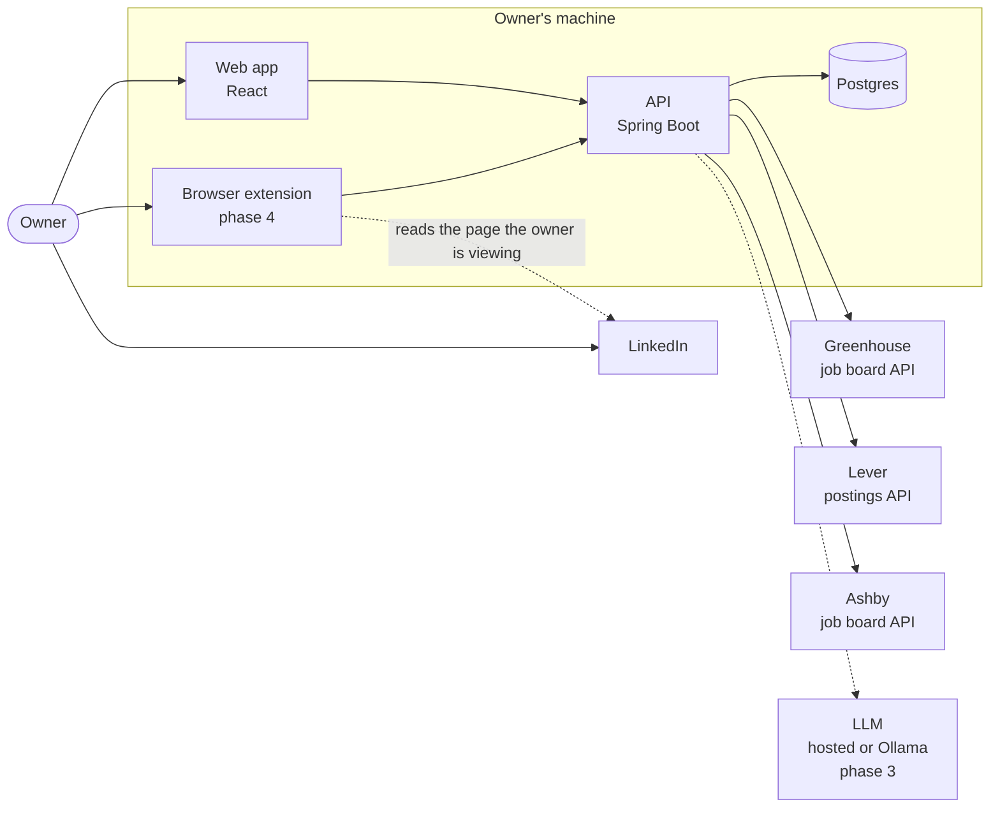
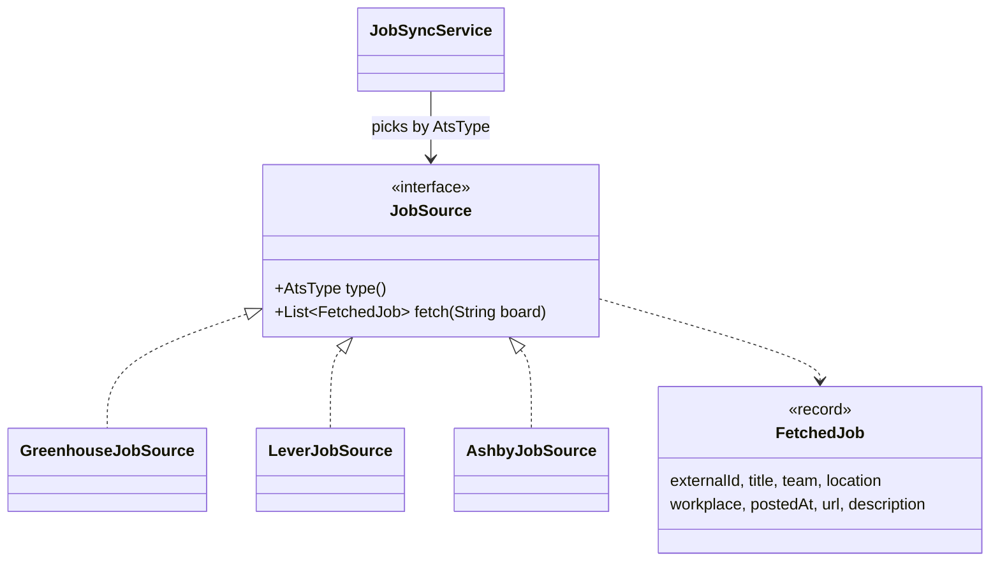
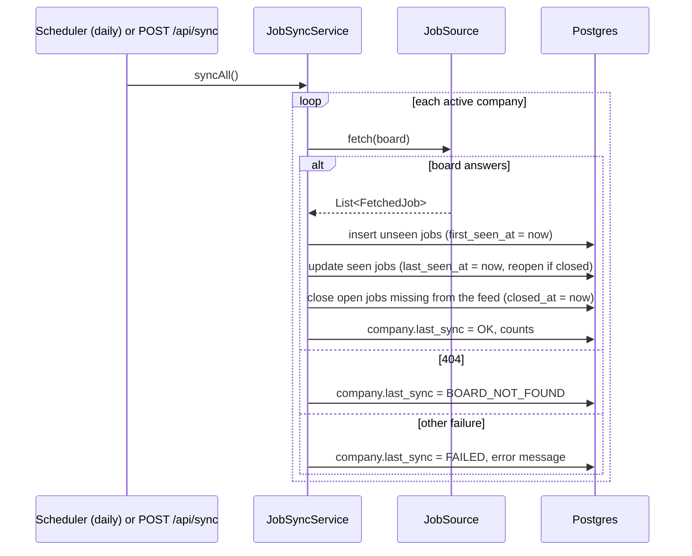
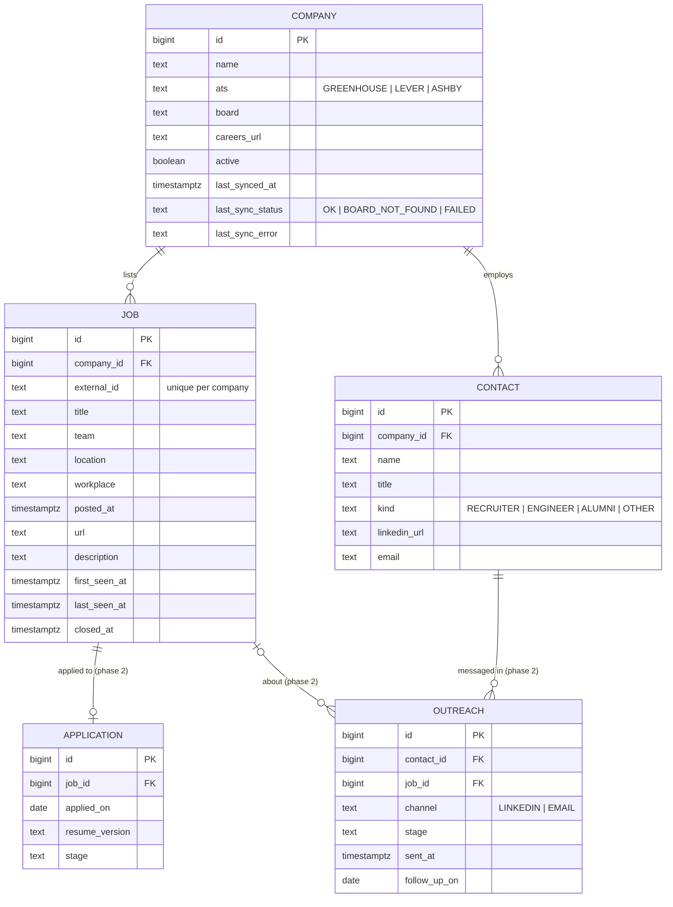
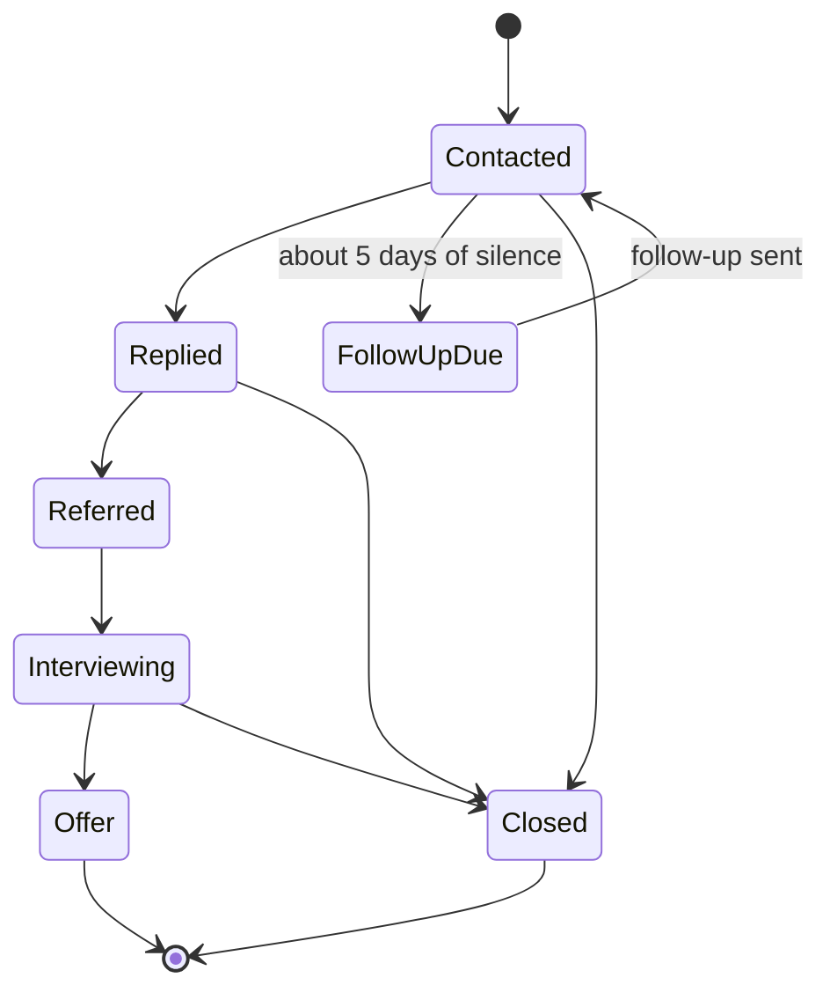

# System design

This is the design of Job Search Assistant: what it does, how the parts fit, and why it is built this way. The product brief is in [BRIEF.md](BRIEF.md); decisions with real trade-offs are recorded as ADRs in [adr/](adr/).

## 1. Problem

Applying cold has a low response rate. A referral from someone inside the company is the strongest signal a candidate can send, and it works best when the role is fresh. The work around a referral is tedious: watching career pages, spotting new roles, finding the right person, writing a personal note, remembering to follow up, and filling the same application forms again and again.

The app does that work. The owner keeps every judgement call and every send.

## 2. Goals and non-goals

**Goals**
- Pull open roles every day from the hiring systems (ATS) that target companies use, and flag what is new.
- Narrow those roles with cheap filters first, then rank the shortlist against the owner's resume with AI.
- Keep a record of the people at each company and every conversation with them, with follow-up reminders.
- Draft personal referral messages and tailored application documents for the owner to review.
- Fill application forms in the browser so that applying is mostly review.

**Non-goals**
- A multi-user product. There is one user, on one machine.
- Volume. The target is 10 to 20 personal messages a day, not hundreds.

**Anti-goals** (the app has failed if it does these, even if it works)
- Automating LinkedIn in any way: scraping, sending messages or connection requests, or applying. It breaks LinkedIn's User Agreement and would put the owner's account at risk.
- Submitting anything without the owner pressing the button. Legal attestations (work authorization, sponsorship, EEO) must be the owner's own answers.
- Inventing experience in a resume or cover letter.
- Costing money to run, beyond free tiers.

## 3. System context

The API is the only thing that talks to the outside world, and it only reads from it. LinkedIn appears only as a page the owner is looking at: the extension reads that one page when the owner clicks, and never navigates or sends.

## 4. Components

| Component | Tech | Responsibility |
|---|---|---|
| `backend/` | Java 21, Spring Boot 3.5, JPA, Flyway | REST API, ATS clients, daily sync, tracker, AI calls |
| `frontend/` | React 19, Vite, Tailwind, TanStack Query | Jobs inbox, companies, tracker board |
| Postgres 16 | Docker Compose | All state |
| Browser extension | Chrome MV3, unpacked | Save a viewed profile; fill application forms (phase 4) |

The backend is organised **by feature** rather than by layer (`company`, `job`, `job.source`, `tracker`), so each feature's entity, repository, service and controller sit together. See [ADR 0002](adr/0002-package-by-feature.md).

## 5. Job ingestion

### 5.1 Sources

Each ATS publishes a public, read-only JSON feed with no key:

| ATS | Endpoint | Board in careers URL |
|---|---|---|
| Greenhouse | `GET boards-api.greenhouse.io/v1/boards/{board}/jobs?content=true` | `boards.greenhouse.io/{board}`, `job-boards.greenhouse.io/{board}` |
| Lever | `GET api.lever.co/v0/postings/{board}?mode=json` | `jobs.lever.co/{board}` |
| Ashby | `GET api.ashbyhq.com/posting-api/job-board/{board}` | `jobs.ashbyhq.com/{board}` |

Workday has no public API and LinkedIn-only listings can't be pulled; both are handled later by pasting a job link.

### 5.2 One interface, one client per ATS

Each client maps its feed into the same `FetchedJob` record, so nothing past the client knows which ATS a job came from. Adding SmartRecruiters or Workday later means adding one class. A board that answers 404 throws `BoardNotFoundException`, which the sync records as `BOARD_NOT_FOUND`: companies switch ATS, and the UI asks the owner for a fresh careers link.

Normalisation rules worth knowing:
- **Workplace** is one of `REMOTE`, `HYBRID`, `ONSITE`, `UNKNOWN`. Ashby's `workplaceType` wins over its `isRemote` flag, which is also `true` for hybrid roles. Greenhouse carries it in a "Workplace Type" metadata field.
- **Posted date** is Greenhouse `first_published`, Lever `createdAt` (epoch ms), Ashby `publishedAt`.
- **Description** is stored as plain text. Greenhouse sends HTML-escaped HTML, which is unescaped and stripped.

### 5.3 Sync

- Companies sync one at a time, and each in its own transaction, so one broken board never rolls back the others.
- A job is **new** when its `first_seen_at` is after a cut-off (default: the last 24 hours). Fresh roles are the best time to ask for a referral, so the inbox sorts and badges by this.
- Jobs are never deleted. A job that leaves the feed is **closed**, so the tracker keeps its history; if it reappears, it reopens.
- The schedule is a cron expression in config (`app.sync.cron`, default 07:00 daily). Running it on a laptop means a missed day is caught by the next run or by the "Sync now" button; nothing depends on exact timing.
- Requests are polite: one request per company per sync, a descriptive `User-Agent`, and timeouts.

### 5.4 Adding a company

The owner pastes a careers link. `AtsDetector` recognises the host and pulls out the board (`jobs.lever.co/palantir` → Lever, `palantir`). An unknown link is rejected with a message, and the owner can pick the ATS and board by hand.

## 6. Data model

Schema changes go through Flyway migrations in `backend/src/main/resources/db/migration`. Hibernate only validates the schema; it never changes it.

## 7. Tracker (phase 2)

Every conversation and application moves through one pipeline:

`follow_up_on` is set when a message is sent and cleared when a reply is logged. The board's "Due today" column is a query on that date, so no background job is needed. Reply rates are grouped by message style to show what works.

## 8. AI (phase 3)

- **Filter before calling AI.** Keyword, location, workplace and seniority filters run in SQL first; only the shortlist (about 30 jobs a day) is scored.
- **Match:** the model gets the resume and a job description and returns a score with reasons, stored with the job so it is paid for once.
- **Drafting:** referral messages, follow-ups and cover letters are drafted from the resume, the role and a real connection point. The prompt forbids claiming experience that is not in the resume, and the owner edits before anything is used.
- **Provider behind an interface:** a small hosted model (a few dollars a month) or a local model through Ollama ($0, resume stays on the machine). See [ADR 0003](adr/0003-ai-provider-abstraction.md).

## 9. Browser extension (phase 4)

- **Save profile:** on a profile page the owner is viewing, one click sends name, title, company and URL to `POST /api/contacts`. It reads only the current page, only on click.
- **Fill applications:** on Greenhouse, Lever, Ashby and Workday application pages it fills contact details, links, history, the resume upload and drafted answers from the answer bank. It never clicks submit, and it leaves attestation questions (work authorization, sponsorship, EEO, background checks) for the owner.

## 10. Cross-cutting concerns

| Concern | Approach |
|---|---|
| Security | One user on localhost. The API binds to `127.0.0.1` and has no login; CORS allows only the frontend origin. If it is ever hosted, auth comes first. See [ADR 0001](adr/0001-single-user-local-first.md). |
| Personal data | The resume and answer bank live in `private/`, which git ignores. Nothing personal is committed. |
| Errors | One `@RestControllerAdvice` returns RFC 7807 problem details. Sync failures are stored per company, not thrown at the scheduler. |
| Testing | Unit tests for detection and mapping, ATS clients against recorded real responses, and repository and API tests against real Postgres via Testcontainers. CI runs them all. |
| Observability | Spring Boot Actuator health; structured logs per sync run with counts. |
| Cost | $0: public APIs, local Docker, free tiers only. |

## 11. Roadmap

| Phase | Scope | Status |
|---|---|---|
| 1 | Companies, ATS detection, Greenhouse/Lever/Ashby sync, jobs inbox with filters and "new" flag | Done |
| 2 | Contacts, outreach and application tracker, follow-up reminders | Planned |
| 3 | AI match scoring and message drafting | Planned |
| 4 | Browser extension: save profile, fill applications | Planned |
| 5 | Tailored resumes and cover letters, answer bank, reply-rate stats | Planned |
